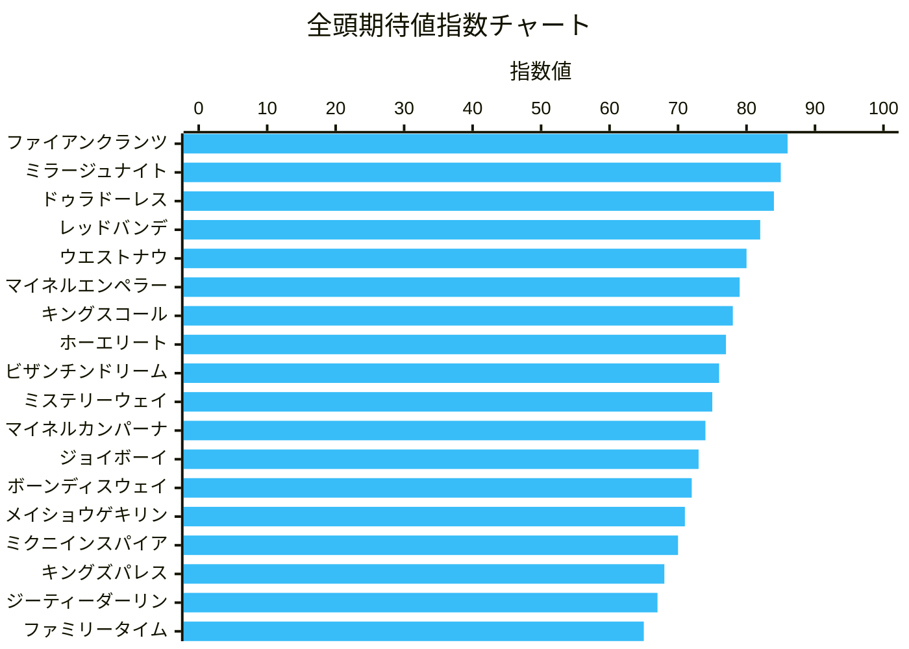

### レース情報

- <b>日付:</b> 2026-11-08
- <b>開催場:</b> 東京
- <b>レース番号:</b> 11
- <b>レース名:</b> アルゼンチン共和国杯
- <b>条件:</b> 芝2500m / 左回り / 晴・良馬場 / 出走頭数: 18頭（Bコース）

---

### レース総合判定

- <b>指数分布ステータス:</b> 【3〜4頭・上位拮抗型】
- <b>予想自信度:</b> 【B】 （上位4頭が80点台前半〜中盤で密集、枠と展開で着順が左右される通常重賞）
- <b>波乱度:</b> 【中波乱】 （ハンデ差と多頭数・坂2回のタフな舞台で伏兵の台頭余地が大きい）
- <b>推奨馬券アプローチ:</b> （東京長距離実績が抜けている上位実力馬を軸に、コース有利な内枠勢と軽ハンデの伏兵を絡めたフォーメーション）

---

### 予想の観点・注目ポイント

- <b>馬場・バイアス想定:</b> Bコース替わり初週。内柵沿いに軽微な傷みはあるものの全体的にクッション値9.9と良好な良馬場。直線が長いとはいえ、コーナーを4回回る2500m戦の物理特性上、<b>「内枠（1〜3枠）をロスなく立ち回った先行・好位差し」</b>が圧倒的に有利。外枠勢は距離ロス軽減の立ち回りが必須。
- <b>展開の鍵:</b> 昨年覇者18ミステリーウェイが大外からハナを主張し、1ジーティーダーリン、12メイショウゲキリンが追走。スタート直後の坂上りにより前半ペースは落ち着き、向正面で息が入るスロー〜平均ペース。残り800m付近からの持続力ロングスパート勝負。
- <b>コース適性・関連コース:</b> 春の同コース重賞「目黒記念」や「東京芝2400m（青葉賞・ダービー等）」での持続力勝負・坂越え実績が直結。急坂を2度上るタフなレイアウトゆえ、血統的にもドゥラメンテやハーツクライなどスタミナ型中長距離血統が優位。

---

### 展開予想

- <b>ハナ・逃げ:</b> 18 ミステリーウェイ
- <b>好位・先行:</b> 1 ジーティーダーリン, 12 メイショウゲキリン, 17 キングスコール, 3 マイネルエンペラー
- <b>中団・差し:</b> 4 ミラージュナイト, 5 ドゥラドーレス, 7 ファイアンクランツ, 8 ジョイボーイ, 9 レッドバンデ, 11 ウエストナウ, 15 ホーエリート
- <b>後方・追込:</b> 2 ビザンチンドリーム, 6 ファミリータイム, 10 ボーンディスウェイ, 13 マイネルカンパーナ, 14 ミクニインスパイア, 16 キングズパレス
- <b>展開シミュレーション短評:</b> 18ミステリーウェイが単騎気味に逃げを形成し、道中は落ち着いた流れ。3〜4コーナーから後続が徐々に押し上げ、直線入り口で馬群が凝縮。坂の登坂で早めに抜け出しを図る先行勢に対し、内ラチ沿いで脚を溜めていた4ミラージュナイト、5ドゥラドーレス、外から長くいい脚を使う7ファイアンクランツが坂上で交わしにかかる激戦。

---

### 競馬新聞風印予想

- ◎ 7 ファイアンクランツ （東京長距離の鬼、目黒記念覇者の底力）
- ◯ 4 ミラージュナイト （内枠好位、札幌日経賞勝ちと目黒記念僅差の安定感）
- ▲ 5 ドゥラドーレス （ルメール騎乗×絶好の3枠、末脚の破壊力）
- ☆ 17 キングスコール （目黒記念3着＆55kgの軽斤量、外枠でオッズ妙味抜群）
- △ 9 レッドバンデ （青葉賞2着など東京芝2400m連対率優秀）
- △ 11 ウエストナウ （メトロポリタンS制覇など左回り長距離適性高）
- △ 3 マイネルエンペラー （京都大賞典2着、日経賞2着の実力馬）
- 危険な人気馬: 2 ビザンチンドリーム （59.5kgの酷量、後方一気の脚質で内枠包囲・捌き遅れのリスク大）

---

### 指数ランキングと短評

<callout icon="💡" color="gray_bg">
<b>【指数サマリー】</b> 最高指数: 86点 / 1-2位差: 1点 / 分布: 3〜4頭・上位拮抗型
</callout>

1位 7 ファイアンクランツ 86点

- <b>コース適性: 【S】</b> 春の同舞台・目黒記念勝ち馬。ダイヤモンドS2着、青葉賞2着など東京長距離は現役屈指の適性。
- <b>枠順評価: 【A】</b> 中目の4枠7番。外を回されすぎず、内の混戦も避けられるベストポジション。
- <b>血統面評価: 【S】</b> ドゥラメンテ×母父ハーツクライは当コースで最も走る黄金配合。
- <b>展開利・臨戦評価: 【A】</b> 58kgは目黒記念で克服済み。岩田望来騎手の手腕で直線力強く抜け出す。
- <b>短評総括:</b> 舞台適性・血統背景ともに減点材料が見当たらない。崩れるリスクが極めて低く、本命軸に最適。

2位 4 ミラージュナイト 85点

- <b>コース適性: 【S】</b> 目黒記念0.2秒差、前走札幌日経賞勝ち。菊花賞でも僅差に走ったスタミナの持ち主。
- <b>枠順評価: 【S】</b> 経済コースを通れる2枠4番。コーナー4回のロスを最小限に抑えられる。
- <b>血統面評価: 【A】</b> バゴ産駒で欧州スタミナ血統が前面に出ており、坂を2度上るコースに合致。
- <b>展開利・臨戦評価: 【A】</b> 斤量57kg、西村淳也騎手とのコンビで好位イン差しが完璧に決まる公算大。
- <b>短評総括:</b> 枠の恩恵を最も受ける1頭。ロスのない立ち回りから確実に上位争いへ食い込む。

3位 5 ドゥラドーレス 84点

- <b>コース適性: 【A】</b> 菊花賞4着、左回り中長距離重賞で常に上位。鋭い末脚は東京でこそ真価を発揮。
- <b>枠順評価: 【S】</b> 3枠5番の絶好枠。イン溜めからの直線外出しがスムーズに行える。
- <b>血統面評価: 【A】</b> ドゥラメンテ×ハービンジャーで底力十分。
- <b>展開利・臨戦評価: 【A】</b> 名手ルメール騎手の手綱。斤量58kgでも決め手の絶対値でカバー可能。
- <b>短評総括:</b> 休み明けでも仕上がり良好なら勝ち負け必至。鞍上込みで外せない対抗格。

4位 9 レッドバンデ 82点

- <b>コース適性: 【A】</b> 前走東京2400mの昇仙峡Sを完勝。青葉賞2着、菊花賞5着とクラシック路線で実力証明済み。
- <b>枠順評価: 【B】</b> 5枠9番。包まれる心配はないが、やや外目を回るリスクはある。
- <b>血統面評価: 【A】</b> キズナ産駒。欧州スタミナの母父で東京の直線を長く伸びてくる。
- <b>展開利・臨戦評価: 【B】</b> 斤量57kg、佐々木大輔騎手の積極策がハマれば単穴逆転まで。
- <b>短評総括:</b> 成長力著しい4歳馬。決め手勝負になれば上位馬とも互角に渡り合える。

5位 11 ウエストナウ 80点

- <b>コース適性: 【A】</b> 東京芝2400mのメトロポリタンSを勝利。左回りの中長距離での立ち回りが巧み。
- <b>枠順評価: 【B】</b> 6枠11番。横山典弘騎手がどう折り合いをつけて内へ滑り込ませるかが鍵。
- <b>血統面評価: 【B】</b> キズナ×Frankel。瞬発力よりも持続力に秀でる。
- <b>展開利・臨戦評価: 【B】</b> 前走京都大賞典4着と調子維持。57.5kgも許容範囲。
- <b>短評総括:</b> 展開が淀みなく流れてタフな消耗戦になれば浮上してくる実力派。

6位 3 マイネルエンペラー 79点

- <b>コース適性: 【B】</b> 中山・阪神向きの感はあるが、前走京都大賞典2着など地力強化が著しい。
- <b>枠順評価: 【A】</b> 2枠3番。内ラチ沿いでじっくり脚を溜める競馬ができる。
- <b>血統面評価: 【A】</b> ゴールドシップ×ロージズインメイのステイヤーズ血統。スタミナは無尽蔵。
- <b>展開利・臨戦評価: 【B】</b> 58.5kgの斤量はやや重いが、タフな展開になればしぶとく残る。
- <b>短評総括:</b> 東京の高速上がり勝負になるとやや分が悪いが、消耗戦になれば連下筆頭。

7位 17 キングスコール 78点 （★注目穴）

- <b>コース適性: 【A】</b> 今春の目黒記念で逃げて0.2秒差の3着に大健闘した実績あり。
- <b>枠順評価: 【C】</b> 8枠17番と外枠を引いてしまった点が最大の課題。
- <b>血統面評価: 【A】</b> ドゥラメンテ産駒で距離延長は大歓迎。
- <b>展開利・臨戦評価: 【S】</b> 前走京都大賞典大敗で人気急落だが、今回は恵まれた斤量55kg。目黒記念同様の先行策が打てれば激走可能。
- <b>短評総括:</b> 目黒記念3着馬が外枠と近走着順で完全に盲点。55kgの軽斤量を利した粘り込みで高配当を演出する特注穴。

8位 15 ホーエリート 77点

- <b>コース適性: 【A】</b> 目黒記念、ステイヤーズS制覇など長距離重賞の常連。昨年の本レースでも僅差4着。
- <b>枠順評価: 【B】</b> 7枠15番。
- <b>血統面評価: 【A】</b> ルーラーシップ×ステイゴールド。スタミナはメンバー上位。
- <b>展開利・臨戦評価: 【C】</b> 牝馬ながら56.5kgは見込まれた印象。斤量泣きのリスクあり。
- <b>短評総括:</b> 底力は認めるが、斤量面での不利を考慮し相手抑えまで。

9位 2 ビザンチンドリーム 76点

- <b>コース適性: 【B】</b> 天皇賞春・海外重賞好走などスタミナは一級品だが、東京の決め手比べは未知数。
- <b>枠順評価: 【B】</b> 最内1枠2番だが、後方一気の不器用なタイプだけに包まれる危険大。
- <b>血統面評価: 【A】</b> エピファネイア×ジャングルポケット。
- <b>展開利・臨戦評価: 【D】</b> トップハンデ59.5kgはあまりに過酷。宝塚記念大敗からの臨戦も割引き。
- <b>短評総括:</b> 実績は最上位だが、酷量と脚質リスクから今回は過信禁物。

10位 18 ミステリーウェイ 75点

- <b>コース適性: 【A】</b> 昨年の当レース勝ち馬。単騎逃げの形に持ち込めればしぶとい。
- <b>枠順評価: 【D】</b> 大外8枠18番。ハナを主張するまでに脚を使わされる。
- <b>血統面評価: 【B】</b> ジャスタウェイ産駒。
- <b>展開利・臨戦評価: 【C】</b> 昨年より斤量2kg増の58kg。マークも厳しくなる。
- <b>短評総括:</b> 展開ひとつで残る可能性はあるが、外枠と斤量増の二重苦で抑えまで。

11位 13 マイネルカンパーナ 74点

- <b>コース適性: 【A】</b> 昨年当レース2着、ステイヤーズS2着。東京長距離のリピーター。
- <b>枠順評価: 【C】</b> 7枠13番。
- <b>血統面評価: 【B】</b> ゴールドシップ産駒。
- <b>展開利・臨戦評価: 【B】</b> 56kgの手頃な斤量だが、近走のレース内容に精彩を欠く。
- <b>短評総括:</b> 舞台適性は高いが近走状態面で一段落ちる。押さえの評価。

12位 8 ジョイボーイ 73点

- <b>コース適性: 【B】</b> 3勝クラスを勝ち上がったばかり。阪神・京都で実績。
- <b>枠順評価: 【B】</b> 4枠8番。
- <b>血統面評価: 【C】</b> 母父ダイワメジャーが2500mではスタミナ的に割り引き。
- <b>展開利・臨戦評価: 【B】</b> 横山武史騎手と斤量55kgは魅力だが、クラスの壁がある。
- <b>短評総括:</b> 昇級初戦かつ距離延長でここは試金石。

13位 10 ボーンディスウェイ 72点

- <b>コース適性: 【B】</b> 昨年当レース0.2秒差4着だが、基本は中距離タイプ。
- <b>枠順評価: 【B】</b> 5枠10番。
- <b>血統面評価: 【B】</b> ハーツクライ産駒。
- <b>展開利・臨戦評価: 【B】</b> マーカンド騎乗は不気味だが、近走の末脚に見劣り。
- <b>短評総括:</b> 立ち回りひとつで掲示板前後はあるが勝ち負けまでは遠い。

14位 12 メイショウゲキリン 71点

- <b>コース適性: 【C】</b> 前走オールカマーを重馬場で逃げ切ったが、東京芝の良馬場瞬発戦は不向き。
- <b>枠順評価: 【C】</b> 6枠12番。同型18番との兼ね合いが難しい。
- <b>血統面評価: 【B】</b> キズナ産駒。
- <b>展開利・臨戦評価: 【C】</b> 斤量58kgを背負って目標にされる苦しい立場。
- <b>短評総括:</b> 前走は馬場に恵まれた面が強く、東京2500mでの再現性は低い。

15位 14 ミクニインスパイア 70点

- <b>コース適性: 【C】</b> 日経賞2着など中山2500m巧者。直線の長い東京コースでは決め手不足。
- <b>枠順評価: 【C】</b> 7枠14番。
- <b>血統面評価: 【C】</b> アドマイヤマーズ産駒で距離の限界がある。
- <b>展開利・臨戦評価: 【C】</b> 前走京都大賞典でも大敗、変わり身を期待するのは酷。
- <b>短評総括:</b> 適性ズレ（中山特化型）が顕著で手が出しづらい。

16位 16 キングズパレス 68点

- <b>コース適性: 【B】</b> 新潟大賞典など左回り中距離実績はあるが、2500mは距離が長い。
- <b>枠順評価: 【D】</b> 8枠16番。大外を回されるロスが大きい。
- <b>血統面評価: 【B】</b> キングカメハメハ産駒。
- <b>展開利・臨戦評価: 【C】</b> 近走追走力・決め手ともに陰りが見られる。
- <b>短評総括:</b> 距離延長＋外枠で好走条件が揃っていない。

17位 1 ジーティーダーリン 67点

- <b>コース適性: 【C】</b> 阪神芝2000mの垂水S逃げ切りが最高実績。長距離重賞では厳しい。
- <b>枠順評価: 【A】</b> 1枠1番を引いたが、同型が多くハナを取りきれるか微妙。
- <b>血統面評価: 【B】</b> サートゥルナーリア産駒。
- <b>展開利・臨戦評価: 【C】</b> 前走チャレンジCで殿負け。メンタル・体調面に疑問。
- <b>短評総括:</b> 距離延長での重賞挑戦はハードルが高すぎる。

18位 6 ファミリータイム 65点

- <b>コース適性: 【C】</b> 日経新春杯勝ちがあるが近走は二桁着順続き。
- <b>枠順評価: 【B】</b> 3枠6番。
- <b>血統面評価: 【B】</b> リアルスティール産駒。
- <b>展開利・臨戦評価: 【D】</b> 近走大敗続きで復調の兆しが見えず。
- <b>短評総括:</b> 能力的に現級オープンでの頭打ち感が否めない。

---

### 買い目推奨・馬券戦術

- <b>戦術方針:</b> 上位拮抗型ながら、東京長距離実績が抜けている◎ファイアンクランツと◯ミラージュナイトの2頭が堅実。相手には内枠の有力馬に加え、目黒記念3着の実績がありながら軽斤量55kgで放置されている☆キングスコールを絡めた回収率重視のフォーメーションで組み立てる。
- <b>勝負買い目（資金70%）:</b>
- <b>馬連・馬単フォーメーション（4点）:</b>
- 1頭目: 7
- 2頭目: 4, 5
- 7 → 4, 5（馬単・馬連）
- <b>3連複フォーメーション（9点）:</b>
- 1頭目: 7
- 2頭目: 4, 5, 17
- 3頭目: 3, 4, 5, 9, 11, 17
- <b>妙味・抑え（資金30%）:</b>
- <b>ワイド（2点）:</b>
- 7 - 17
- 4 - 17
- <b>3連複抑え（3点）:</b>
- 4 - 5 - 7, 9, 17
- <b>合成オッズ・トリガミ注意点:</b> 馬連7-4、7-5は人気集中が予想されるため資金を厚めに配分。☆17キングスコールが絡んだ馬券は一気に跳ね上がるため、ワイド・3連複のヒモ抜けを防ぐ。危険指定の2ビザンチンドリームは上位入着リスク（3着残り）があるため、少額の3連複3列目抑え以外は完全に切って期待値を高める。

### コース分析

### 1. コース構造と物理的バイアス

- <b>スタート〜初角の距離と形状:</b> スタンド前の上り坂途中からスタート。1コーナーまでの距離は約450mと十分にあるが、スタート直後から急坂を上るためテンのペースは上がりにくい。先行争いは激化しにくく、自然と隊列が決まりやすい。
- <b>高低差と起伏:</b> コース全体の高低差は最大2.7m。スタート直後と最後の直線で計2回、同じ急坂（高低差2.0m）を駆け上がるタフなレイアウト。坂スタートのため前半は極めて息が入りやすいが、後半にスタミナの底力が問われる。
- <b>直線とコーナー:</b> コーナーを計4回回る。東京芝2400mよりもコーナーリングの器用さと立ち回りが問われる。直線は525.9mと長く、コーナーでのマクリはロスが大きいため決まりにくく、基本は直線に向いてからの末脚勝負となる。
- <b>枠順バイアス:</b> <b>明確に内枠有利・外枠不利</b>。1〜2コーナーまでの距離はあるものの、コーナーを4つ回る長距離戦のため、外枠を引くと道中で外を回らされる距離ロスが致命傷になりやすい。特に1〜3枠の好走率・回収率が高い。

### 2. ラップ構造・レース質

- <b>典型的なラップパターン:</b> 後傾ラップ（中弛みからのロングスパート戦）。前半は上り坂発走のためペースが落ち着き、向正面にかけてもスローで流れる。残り800m〜600m（3〜4コーナー中間）から徐々に加速し、ラスト3F〜4Fの持続力比べになる。L2（残り400m〜200m）の直線坂下で最速ラップを踏むことが多い。
- <b>求められる能力タイプ:</b> 長丁場と2度の坂越えを耐えうる「無尽蔵のスタミナ」、直線で減速しない「トップスピードの持続力（ロングスパート性能）」、内ラチ沿いをロスなく立ち回る「コーナリングセンスと折り合い」。

### 3. 関連コース・非関連コース（適性リンク）

- <b>高関連コース（適性が直結するコース）:</b>
- 【東京芝2400m】: 同じ左回りの大箱コース。直線での長い末脚勝負という根本的な要求適性が合致する（ただし2500mの方がよりスタミナ・内枠バイアスが強まる）。
- 【阪神芝2400m（外回り）】: ゆったりした流れからの直線長い持続力勝負、かつ急坂を2回経験する点が極めて類似しており、好走馬の親和性が高い。
- 【京都芝2400m（外回り）】: 序盤スローからの下り坂を利用した後半ロングスパート勝負になりやすく、要求されるスタミナ持続力が共通する。
- <b>非関連コース（適性が真逆で過大評価禁物のコース）:</b>
- 【中山芝2500m】: 同じ距離だが小回りでコーナー6回、かつ直線が短くトリッキー。中山特有の急激なマクリ合戦や機動力勝負に特化したタイプは、直線の長い東京芝2500mでは決め手不足で失速しやすい。

### 4. 有利な血統系統（種牡馬・母父）

- <b>好走傾向のある父・系統:</b>
- <b>ハーツクライ系（ハーツクライ、スワーヴリチャードなど）</b>: 直線での持続力勝負に強く、東京芝の中長距離に抜群の実績。トニービンの血が東京の長い直線で活きる。
- <b>キングカメハメハ系（ルーラーシップ、ドゥラメンテなど）</b>: 豊富なスタミナとタフな持続力を伝えるため、坂を2度上る2500mにマッチする。
- <b>ステイゴールド系（オルフェーヴル、ゴールドシップなど）</b>: 消耗戦・長丁場に強く、タフな展開になれば浮上。
- <b>好走傾向のある母父・系統:</b>
- <b>トニービン（グレイソヴリン系）</b>: 広い東京コースの直線で長くいい脚を使うための必須級血統。
- <b>サドラーズウェルズ系・ロベルト系</b>: 直線の坂でバテない底力とスタミナを補完する欧州スタミナ型が優勢。
- <b>不振・割引となる系統:</b>
- <b>スピード特化型サンデーサイレンス系（ダイワメジャーなど）</b>: 距離の壁が高く、直線の急坂で失速する。
- <b>純粋な短距離型ノーザンダンサー系（米国型ダンチヒ、ストームキャット系など）</b>: スローの瞬発力戦であってもスタミナ切れを起こす。

### 5. 予想の急所・狙い目ポイント

- <b>1〜3枠に入った「先行〜イン差し」タイプを最重要視:</b> 物理的に内をロスなく立ち回れるアドバンテージが非常に大きい。外枠の人気馬を嫌い、内枠の穴馬（特に経済コースを通れる先行・好位差し）を積極的に狙う。
- <b>ハンデ戦（目黒記念・アルゼンチン共和国杯）における「軽ハンデ馬」の台頭:</b> 坂を2回上るタフな2500mでは、斤量1〜2kgの差が最後の直線の坂登坂時にスタミナ消費量として明確に出る。特に53〜55kgあたりの上り馬の激走に警戒。
- <b>前走東京芝2400m・芝2000mで「上がり最速・差し届かず」の敗戦馬:</b> 距離延長とペースの落ち着きにより追走が楽になり、さらに直線の長さで末脚が完全に届くようになるため、巻き返しの好走パターンになりやすい。
- <b>長距離戦における「ルメール騎手」「レーン騎手」など長距離巧者の信頼度:</b> ペース配分、1〜2コーナーでのポジション取り、折り合いが極めて重要なコースのため、長距離のペース判断に長けたトップジョッキーの腕の差が着順に直結する。

### 単勝オッズ

- 4: 6
- 9: 6
- 7: 6.1
- 5: 7.4
- 2: 8.8
- 8: 13.6
- 11: 14
- 3: 15.7
- 17: 18
- 14: 21.3
- 12: 27.8
- 16: 28.4
- 1: 29.3
- 15: 29.8
- 18: 42.7
- 10: 72.3
- 6: 73.8
- 13: 95.8

---

BASHIRAで取得　2026-11-08 東京 11R アルゼンチン共和国杯　実行者: tester　course\_variant: null（内・外コースのデータは無い）

オッズ種別: デフォルト　オッズ観測時刻（JST）: 2026-11-08T09:13\:30+09\:00　オッズ: あり

指定モデル（course）: gemini-flash-latest　指定モデル（race）: gemini-flash-latest

応答モデル modelVersion（course）: gemini-3.8-flash　応答モデル modelVersion（race）: gemini-3.8-flash

プロンプト版（course）: v1　プロンプト版（race）: v1

